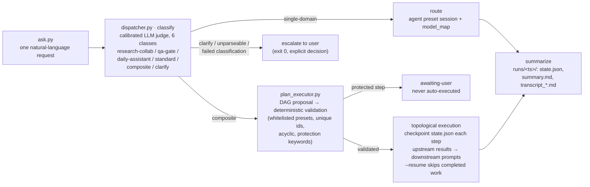

# scheduler

[](https://github.com/aidless/scheduler/actions/workflows/static-checks.yml)

A single-entry dispatcher for a fleet of local AI agent sessions: it takes an arbitrary natural-language request, classifies it with a calibrated judge, routes it to the right specialist agent preset (or plans it as a subtask DAG), executes, and returns one aggregated report.

> **Research prototype.** This was extracted from a personal research workspace and drives a specific local agent host (JSON-RPC over HTTP at `http://127.0.0.1:3080/api`) — it is not a general-purpose library. See [Quick start](#quick-start) for what must be configured before reusing it.

## What it is

`scheduler` implements the "single front door" pattern for a multi-agent workspace: instead of choosing which agent session to open, the user issues one request to `ask.py` and the scheduler handles classification, routing, execution, and reporting.

The pipeline:

1. **Classify** — a prompt-frozen LLM judge labels the request as one of six classes: `research-collab`, `qa-gate`, `daily-assistant`, `standard` (single-domain), `composite` (multiple domains), or `clarify` (ambiguous). The judge is calibrated against gold sets that are true *by construction* (no human labeling); committed calibration runs report 0.875–0.97 exact accuracy with 0 parse failures (`calib_classify_*/stats.json`).
2. **Route** — single-domain requests are dispatched to the matching agent preset session on the host (`research-collab`, `qa-gate`, `daily-assistant`, `standard`, plus keyword pre-routes for `paperreview-agent`, `kg-retrieval-agent`, `aigc-studio-agent`). Optional per-preset model mapping (`model_map.json`) is applied via the host's `selectModel`.
3. **Plan and execute** — composite requests go through an LLM planner that proposes a subtask DAG (`plan_executor.py`). The plan is validated deterministically: presets must be whitelisted, ids unique, the graph acyclic, and protection keywords (delete/publish/pay/…) force `protection=true`. Protected subtasks are never auto-executed — they return `awaiting-user`. Execution is topological with checkpointing: each finished subtask updates `state.json`, upstream results are injected into downstream prompts, and `--resume` skips completed work.
4. **Escalate, don't guess** — `clarify` labels, unparseable plans, and failed classifications escalate to the user instead of being routed somewhere plausible. Escalation is reported as exit code 0 with an explicit decision.
5. **Summarize** — every run writes `state.json`, `summary.md`, and per-task `transcript_*.md` under `runs/<timestamp>/`.

The same pipeline as a diagram, mapped to the real modules:



Design discipline visible in the code:

- **Deterministic guardrails over LLM output** — plan validation and protection keywords do not rely on the model's compliance.
- **Errors count in the denominator** — parse failures are scored as errors, not silently retried; 429/quota responses use a fixed backoff ladder (30/60/120/240/480 s).
- **No silent deletion** — the session ledger `sched_sessions.json` is git-tracked under a no-auto-delete policy; `sched_sessions.py retire` requires `--confirm` and only marks the ledger (it never touches host sessions).
- **Preregistered experiments** — calibration and A/B studies use frozen analysis plans (`analysis_plan_fleet_r4.json`, `model_map.json`), deterministic scoring (assert-and-run, no LLM judge), and exact McNemar tests. The committed `fleet_r4_report.md` documents a null result honestly: two coding A/B rounds both hit the ceiling (16/16 vs 16/16), so the model mapping stays opt-in with "no detectable difference" disclosed rather than claimed.

## Quick start

**Requirements:** Python 3.10+. Standard library only — the scripts import nothing outside `argparse`, `json`, `urllib`, `subprocess`, `re`, `time`, `pathlib`, etc. There is no `pip install` step.

**Prerequisite (for anything that talks to models):** a local agent host exposing JSON-RPC over HTTP at `http://127.0.0.1:3080/api`, with agent presets named `research-collab`, `qa-gate`, `daily-assistant`, `standard`, and `minimal`. The endpoint and working directory are hardcoded constants at the top of each script (`BASE = "http://127.0.0.1:3080/api"`, `CWD = ...`) — edit them to point at your own host. Scripts that only run pure logic or self-validation need no host at all.

Offline (no host, no model calls):

```bash
python test_plan_executor.py        # plan-executor logic tests (stubbed dispatch) → ALL PASS
python ask.py --check-routes        # routing source-of-truth consistency check
python ask.py --list-routes         # presets + keyword routes (also --format json|md)
python validate_coding_tests.py     # self-validate coding A/B assertions (reference impls)
python validate_coding_r4_tests.py  # same, for the 16-task fleet-r4 set
python sched_sessions.py stats      # inspect the session ledger
```

**Verified offline (this tree, 2026-11-01):** `test_plan_executor.py` → 13 checks ALL PASS;
`ask.py --check-routes` → 7 presets / 46 keywords, no ambiguity; both
`validate_coding_*.py` → ALL_TESTS_VALID. All exit 0, no third-party imports.

Full pipeline (requires the agent host):

```bash
python ask.py "Fix the login page error, then turn the meeting notes into a document"
python ask.py "<request>" --plan-only           # show the plan and budget, don't execute
python ask.py --resume runs/<ts>/state.json     # resume a run from its checkpoint
python ask.py "<request>" --no-model-map        # disable per-preset model mapping
```

Artifacts land in `runs/<timestamp>/` (`state.json`, `summary.md`, `transcript_*.md`).

Calibration and experiments (requires the agent host; gold sets and task files are committed):

```bash
python classify_run.py --gold gold_classify_v1.json --out calib_classify_v1   # classify-judge calibration
python classify_run.py --gold gold_classify_v2.json --out calib_classify_v2gold
python coding_model_ab.py --tasks coding_r4_tasks.json --work ab_work_r4     # preregistered coding A/B
python probe_models.py --out probe_models.json                               # dump host model catalog
python probe_preset_defaults.py                                              # per-preset default models
python verify_select_model.py --preset standard --provider <p> --model <m>   # prove selectModel takes effect
```

## Repository structure

```
ask.py                    Unified entry point: classify → route → execute → summarize;
                          --list-routes / --check-routes introspection
dispatcher.py             Core P1 dispatch loop (classify, single-domain routing, escalation)
plan_executor.py          P2 composite planner: DAG proposal, deterministic validation,
                          topological execution, checkpoint/resume, aggregation
classify_run.py           Calibrated classify-judge runner (gold set → verdicts + stats)
classify_gold_gen.py      Gold set generator (truth by construction; needs the original
                          workspace's frozen task files, which are not in this repo)
sched_sessions.py         Session ledger management: list / stats / retire (--confirm)
coding_model_ab.py        Preregistered A/B of model mapping on coding tasks
                          (deterministic assert-and-run scoring, exact McNemar)
probe_models.py           Probe the host's model catalog (session.models)
probe_preset_defaults.py  Probe each preset's default model
verify_select_model.py    Three-step evidence that selectModel actually reroutes
verify_tool_plugin.py     E2E check that the scheduler tool is visible to agent sessions
demo_tool_dispatch.py     Demo: an agent session dispatching through the scheduler tool
test_plan_executor.py     Pure-logic tests for plan_executor (no model calls)
validate_coding_tests.py  Self-validate A/B task assertions with reference implementations
validate_coding_r4_tests.py  Same, for the 16-task fleet-r4 set

config.json               Routing threshold and prompt version stamp
model_map.json            Frozen (preregistered) per-preset model mapping — currently
                          all null: keep provider defaults, mapping is opt-in
gold_classify_v1.json     Committed gold sets for the classify judge
gold_classify_v2.json
coding_ab_tasks.json      Coding A/B task sets with deterministic assertions
coding_r4_tasks.json
analysis_plan_fleet_r4.json  Frozen analysis plan for fleet-r4
fleet_r4_report.md        A/B results report (null result, disclosed as such)
sched_sessions.json       Git-tracked session ledger (no-auto-delete policy)

calib_classify_v1/        Committed calibration runs: verdicts, escalation pairs, stats
calib_classify_v2gold/
calib_classify_china/
calib_l1_baidu/
ab_work/                  A/B artifacts: generated code + assertions per task/arm
ab_work_r4/
ab_work_regression/
runs/                     Committed example run outputs (state.json + summary.md)
smoke/                    Committed smoke-test runs (one per class + composite/clarify)
smoke_p2/                 Smoke tests for planner/DAG execution paths
smoke_p3/                 Smoke test for model mapping
```

## License

MIT — see [LICENSE](LICENSE).

## 本机可重跑性

`make eval` 跑两套离线测试：验收题库 `python3 eval/run_cases.py`（20 条，必须 20/20）与纯逻辑测试 `python3 test_plan_executor.py`（ALL PASS），全程无模型调用；原入口 `probe_models.py` 需要 `127.0.0.1:3080/api` 的活体 agent host，本机无凭据时服务端回 `unauthorized`，故保留为 `make ci-eval`。

## 验收标准与复算

本仓判为合格的条件是 `python3 eval/run_cases.py` 通过率必须为 100%（20/20），且 `make eval` 退出码必须为 0；任何一条失败即判为不合格。

题库 `eval/cases.jsonl` 的 20 条按 8 个 axis 分布，期望值全部由本仓 API 现算或直接从本仓数据文件解析（不是抄文档）：

| axis | 条数 | 判什么 | 主要依据 |
| --- | --- | --- | --- |
| plan-validation | 3 | `verify_plan` 的合法计划 / 保护层关键词强制标记 / 非法 preset 拒绝 | `plan_executor.py` |
| plan-parse | 2 | `extract_plan_json` 从说明文字中取计划；非字符串入参的异常语义 | `plan_executor.py` |
| dag-topo | 3 | Kahn 分层的链 / 环 / 菱形三种形状 | `plan_executor.py` |
| execution | 3 | 上游答案注入、保护层不投递、上游 fail → 下游 skip | `plan_executor.py` |
| aggregation | 3 | `summary.md` 明细行数、待确认小节、失败与跳过小节 | `plan_executor.py` |
| routing | 2 | `ROUTABLE` 7 个 preset、关键词 46 条且无跨 preset 二义 | `dispatcher.py` |
| ledger | 2 | `sched_sessions.json` 45 条、按 purpose 计数 21/21/3 | `sched_sessions.json` |
| calibration | 2 | `calib_classify_v1` 的 exact_match/n 复算、gold v2 的 n/items/counts 自洽 | `calib_classify_v1/stats.json`、`gold_classify_v2.json` |

三条命令（全部离线，无模型调用）：

```bash
python3 eval/run_cases.py            # 20/20，退出码 0；任一失败退出码 1，题库自身损坏退出码 2
python3 eval/run_cases.py --selftest # 篡改第 1 条期望值 → 必须变红（19/20），退出码 0 证明这套题不是装饰
make eval                            # run_cases + test_plan_executor，两者任一失败则退出码非 0
```

复算说明：`python3 eval/run_cases.py --save` 会把本次逐条结果写到 `eval/run-report.json`（含 `total/passed/failed/failed_by_axis/results`），任何人可用同一命令重跑并逐条比对 `detail`。calibration 两条不是读备份数字，而是拿 `stats.json` 里的 `exact_match / n` 重算出 `exact_accuracy`，不一致时直接报 `MISMATCH`；ledger 与 routing 两条现数条目，README 里的 45 条 / 46 关键词可被独立复算。

失败归因：`run_cases.py` 不只报通过率，失败时按 axis 汇总并逐条点名，例如

```
17/20 cases passed
失败归因（按 axis）：
  execution: 2 条 —— ex-01, ex-03
  ledger: 1 条 —— lg-01
```

含义是「执行链路（上游注入 / 下游 skip）」与「账本条目数」两处口径变了，而不是笼统的「题库挂了」；改实现后按这个分桶先定位模块，再看 `eval/run-report.json` 里对应的 `detail`。
